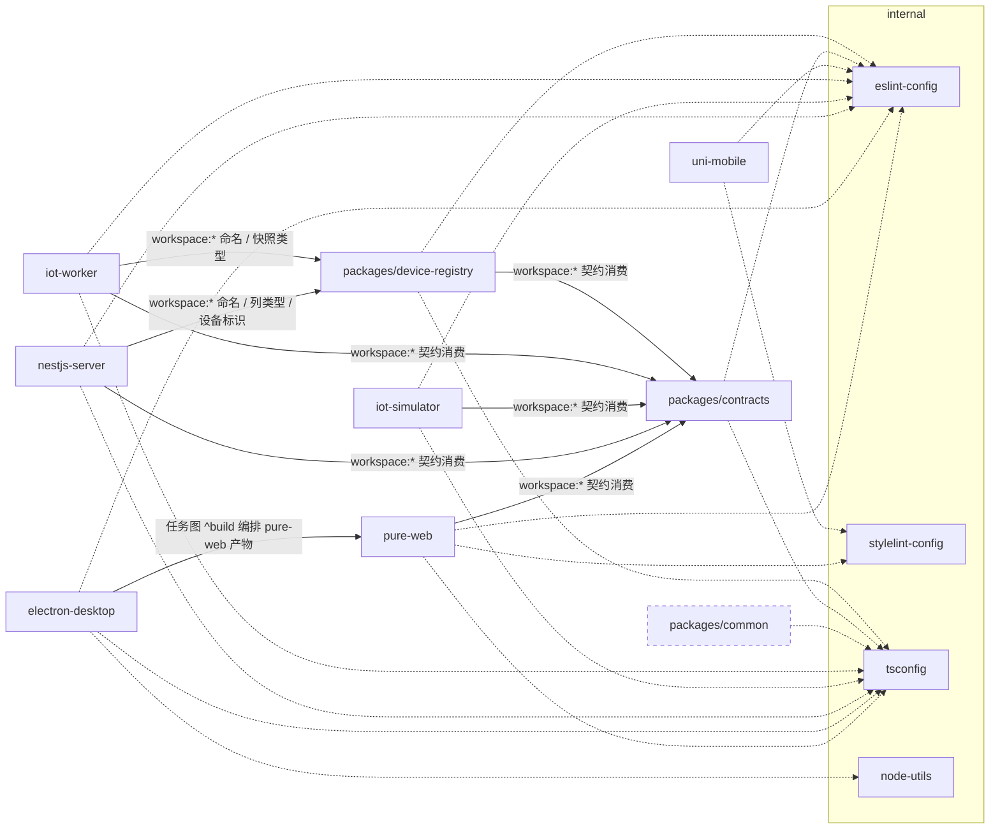

# Monorepo 结构与边界

## Workspace 布局

`pnpm-workspace.yaml` 声明三类包根：`internal/*`、`packages/*`、`apps/*`。

| Workspace | 角色 | 关键事实 |
|---|---|---|
| `apps/pure-web`（`@multi-admin/pure-web`） | Vue3 管理后台 | vue-pure-admin 基底（Element Plus + Tailwind 4 + Pinia）；数据源由 `VITE_MOCK` 切换，语义见 [contracts.md](contracts.md) 的「pure-web 数据源开关」节；`build` 产物注入 `version.json`（generate-version-file）；应用级细节见 [apps/pure-web/AGENTS.md](../../apps/pure-web/AGENTS.md) |
| `apps/nestjs-server`（`@multi-admin/nestjs-server`） | 后端服务 | 骨架与横切基建、Prisma + Redis、认证链（JWT 双令牌轮换 + RBAC 守卫链）、system 三域 CRUD（User / Role / Menu 软删除）、iot 档案四表与只读仓储（并承担 MQTT 订阅投队列、TDengine 建表执行与档案快照重建），单测/e2e 合并覆盖率门禁齐备，前端直连已打通；jest 单测 + e2e 串行，应用级细节见 [apps/nestjs-server/AGENTS.md](../../apps/nestjs-server/AGENTS.md) |
| `apps/uni-mobile`（`@multi-admin/uni-mobile`） | uni-app 多端 | Vue3；Vite 版本被 named catalog `uni-app` 隔离为 5.2.8（uni-app 编译链与主仓 Vite 8 不兼容） |
| `apps/electron-desktop`（`@multi-admin/electron-desktop`） | 桌面端 | 无自身 UI，devDependencies 声明 `@multi-admin/pure-web: workspace:*`，打包时消费其 `dist` 产物；详见 [desktop-app.md](desktop-app.md) |
| `apps/iot-simulator`（`@multi-admin/iot-simulator`） | 设备模拟器 | 设备侧唯一的进程：以 MQTT 上行虚拟设备遥测（缺省 100 台 1 Hz，规模与频率可调），用于打穿接入链路与后续规模压测；消费 `packages/contracts` 的 iot 段主题与载荷契约，见 [backend.md](backend.md) 设备接入链路 |
| `apps/iot-worker`（`@multi-admin/iot-worker`） | 遥测消费者 | 与 HTTP 服务并列的第二个运行时：**不用 Nest、不开 HTTP**，从 BullMQ 队列取原始报文，按业务 Redis 的档案快照解析 / 过滤 / 攒批后 STMT 写入 TDengine；可独立启停 / 多实例 / 扩缩，自备 Dockerfile（**不碰 PG，无 migrate / seed**）；另含四个运维脚本：建库 `tdengine-init.ts`（dev-only，预建原始 / 降采样表，幂等，经 `pnpm ops:tdengine-init` 调用）、降采样对账 `downsample-verify.ts`、子表审计 `subtable-audit.ts`、孤儿清理 `subtable-cleanup.ts`；消费 `packages/contracts` 与 `packages/device-registry` 的命名 / 快照类型；架构见 [iot-worker.md](iot-worker.md)，应用级细节见 [apps/iot-worker/AGENTS.md](../../apps/iot-worker/AGENTS.md) |
| `packages/common`（`@multi-admin/common`） | 跨端共享 TS 代码 | tsdown 构建；暂无应用引用 |
| `packages/contracts`（`@multi-admin/contracts`） | 接口与设备接入契约 | 纯类型 + BizCode/MenuType 常量 + iot 段（主题模板、上行载荷类型、队列名与键前缀）；tsdown ESM+CJS 双格式 + 双 d.ts；nestjs-server、pure-web、iot-simulator 与 iot-worker 以 `workspace:*` 消费；见 [contracts.md](contracts.md) |
| `packages/device-registry`（`@multi-admin/device-registry`） | 存储侧词汇与档案快照类型 | 决定「数据长什么样、叫什么、落到哪一列」：**表名的唯一出处**（`subtableName` / `rawStableName` / `dsStableName` / `dsSubtableName`、`DS_LEVELS`、库名与分钟级 KEEP）；平台 `deviceId` 的签发与校验；**档案快照类型**（`RegistrySnapshot` / 绑定类型 `BindKind`，server 推导、worker 只读）；类型档位表与原始 / 降采样列类型映射；进 DDL 的标识符校验与物模型声明校验 / 列推导（当前只有 server 消费）。按 `contracts.md` 的边界，这些都不属契约。**不装**：DDL 语句、档案读写、报文解析与写入、HTTP / 队列形状。⚠️ **模拟器与 pure-web 都不依赖它**——"平台侧标识不下发"由**依赖边界**保证；依赖 `packages/contracts`；nestjs-server 消费命名、列类型、设备标识与模型推导，iot-worker 消费命名与快照类型 |
| `internal/node-utils` | Node 侧进程工具 | 仅导出 `run` / `runSync`（`process.mjs`），供根 `scripts/check.mjs` 等使用 |
| `internal/eslint-config` | ESLint 基线 | `base.mjs` 导出静态配置数组；`node.mjs` / `vue.mjs` / `typescript.mjs` / `tailwind.mjs` 为工厂，应用侧配置为薄壳 |
| `internal/stylelint-config` | Stylelint 基线 | 导出 `base.mjs` |
| `internal/tsconfig` | TS 配置基线 | `base.json` / `web.json` / `node.json` / `library.json` |

## 构建依赖关系

要点：

- 桌面端构建编排由 `turbo.json` 任务图承担：`build` / `build:dir` 经 `^build` 先构建 pure-web，任何入口（根命令 / `--filter`）均自动编排（决策见 ADR-005）。
- pure-web 与 electron-desktop 是"产物消费"关系而非代码 import 关系：桌面端通过自定义协议托管 pure-web 的静态产物（见 [desktop-app.md](desktop-app.md)）。
- `packages/common` 目前无消费方，新增共享代码时的放置判据见下。
- `packages/contracts` 是首个被前后端双端消费的共享包；契约扩展流程与错误码表见 [contracts.md](contracts.md)。
- `apps/iot-worker` 是与 HTTP 服务**并列的第二个运行时**（队列消费独立成进程，不占 server 进程）；
  `packages/device-registry` 是平台侧标识（`deviceId` / `modelCode`）与**表名的唯一持有者**——模拟器与 pure-web 都不依赖它，"平台侧标识不下发"由依赖边界硬性保证，不靠约定；server 建表与 worker 对账读同一套命名函数。
- `packages/contracts` 的 iot 段同时被发布方（iot-simulator）与消费方（iot-worker）消费，队列名与主题一并一处定义，避免两端漂移。

## 目录放置规则

- **前后端共用的接口与设备契约** → `packages/contracts`；**跨端共享的业务代码** → `packages/common`（先确认 ≥2 端真实消费再下沉，避免提前抽象）。
- **仅仓库工程链使用**（lint 基线、tsconfig、进程工具） → `internal/*`；命名用 npm scope `@multi-admin/<name>`，保持与应用包一致的 workspace 协议引用（`workspace:*`）。
- **单端功能** → 留在对应 app 内，不上提。

## 当前已知的结构事实（非缺陷清单，供决策参考）

- 质量门禁双层：本地 `pnpm check` + husky 钩子，GitHub CI（`.github/workflows/ci.yml`）异步兜底（详见 `docs/engineering/build-and-verify.md`）。
- 前后端已打通：pure-web 缺省直连 NestJS（`VITE_MOCK` 可切离线 mock）；dept/监控/mine-logs 为 mock-only 端点，前端降级空态（见 `docs/governance/backlog.md`）。
- TS 严格度：pure-web 走单一严格配置（extends `@multi-admin/tsconfig/web.json`；
  继承链上 `internal/tsconfig/base.json` 的 `exactOptionalPropertyTypes` 未启用，注释保留），uni-mobile extends `@vue/tsconfig`，nestjs-server 走内部基线；
  测试分层（jest / vitest / Playwright）口径见 `docs/engineering/build-and-verify.md`。
