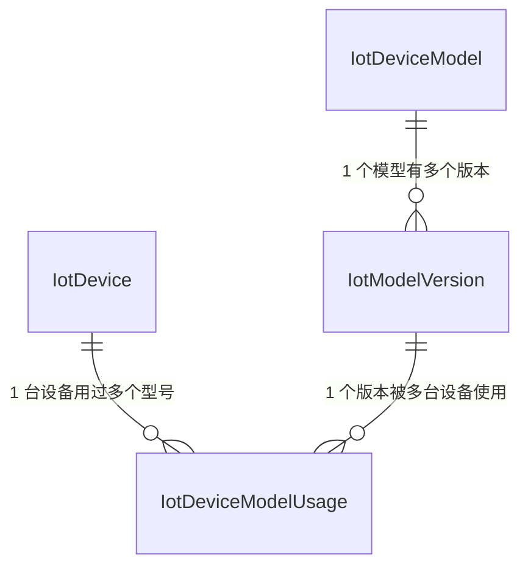

# S2 · 档案落 PG：设计与实施计划

- **日期**：2026-11-05｜上承 [范围定稿](2026-11-01-scope-and-task-map.md) S2 与 [D3 决策卡](2026-11-05-d3-decision-card.md)
- **出口**：① 档案、模型、版本快照、设备模型使用史四张表可读写，**物模型与设备档案真的落到库里、能查出来**；② 仓储层只返回 `ACTIVE`；③ 换型号后旧模型的子表仍被算作合法（审计期望集含历史）；④ 100 台 P1 设备与 `p1` 模型由 seed 注入，幂等
- **前置**：D3 已定（2026-11-05）

## 0. 先说一处计划内部的矛盾

范围定稿 §3 的注里写着「**S2 只定表，不定读取**」（D1 管读取），但 §1 给 S2 的出口是「消费者只认 ACTIVE」——消费者能不能只认 ACTIVE，取决于它**怎么读**档案，那是 D1 + S5 的事。

更要紧的是接口形状：`DeviceRegistry` 的三个方法都是**同步**的（[types.ts](../../../packages/device-registry/src/types.ts)）——

```ts
hasDevice(localDeviceId: string): boolean;
resolve(localDeviceId: string): PointResolution;
allSubtables(): SubtableRef[];
```

而 PG 读取必然是**异步**的。所以「`DeviceRegistry` 接口不变」与「档案落 PG」在当前签名下不可能同时成立。三条出路：

| 出路 | 后果 |
| --- | --- |
| 把接口改成 `Promise` | 违反「接口不变」，且等于替 D1 选了"直连"形态 |
| 内存全量快照，保持同步 | 等于替 D1 选了"快照"形态 |
| **S2 只做仓储，不实现 `DeviceRegistry`** | 接口一字不动，形态留给 D1 |

**本计划取第三条**，并把 S2 的出口第三条改成「仓储层只返回 `ACTIVE`」。原出口的「消费者只认 ACTIVE」移到 S5——那才是消费者真的开始读档案的地方。

**D1 的读取形态暂按直连**（决策人 2026-11-05 定）：worker 侧怎么读档案后续再讨论，但方向按直连走。它对 S2 的直接影响只有一个——**`DeviceRegistry` 的同步签名迟早要改成异步**。S2 因此既不动接口、也不做内存快照：先按快照实现，到 D1 还得拆一遍。

## 1. 形状

| # | 任务 | 落在 |
| --- | --- | --- |
| T1 | Prisma 模型与迁移 | `apps/nestjs-server/prisma/` |
| T2 | 仓储层（只读） | `apps/nestjs-server/src/modules/iot/registry/` |
| T3 | seed：`p1` 模型 + 100 台设备 | `apps/nestjs-server/prisma/` |
| T4 | 单测 | 同模块 `*.spec.ts` |
| T5 | 文档 | `backend.md` / 任务 README |

**三条边界**：

- **不实现 `DeviceRegistry`**（见 §0）——仓储是异步的、面向 server 的；接口的实现形态归 D1
- **不做注册写入**：S2 只落表与读；写入路径归 S4
- **不在仓储层做缓存**：缓存形态由 D1 定，现在加了就是提前替它选

## 2. 设计

### 2.1 T1 数据模型

四张表。状态各一套（D3 §2.3）：**模型的在版本上，设备的在设备上**。

```prisma
enum IotStatus {
  PENDING
  ACTIVE
  FAILED
}

model IotDeviceModel {
  code      String   @id // 模型编码，已折小写（S3 的 checkModelCode 保证）
  name      String?
  createdAt DateTime @default(now())
  versions  IotModelVersion[]
}

model IotModelVersion {
  id            String    @id @default(cuid())
  modelCode     String
  version       Int
  status        IotStatus
  properties    Json // S3 的归一化声明，整份不可变
  services      Json
  events        Json
  effectiveFrom DateTime?
  effectiveTo   DateTime?
  createdAt     DateTime  @default(now())
  model         IotDeviceModel @relation(fields: [modelCode], references: [code])

  @@unique([modelCode, version])
}

model IotDevice {
  id              String    @id @default(cuid())
  localDeviceId   String    @unique
  deviceId        String    @unique // 平台签发，**永不复用**
  protocolVersion String? // '3.1.1' | '5.0'，backlog 的协议版本字段在这里落地
  status          IotStatus @default(PENDING)
  createdAt       DateTime  @default(now())
  usages          IotDeviceModelUsage[]
}

model IotDeviceModelUsage {
  id        String    @id @default(cuid())
  deviceId  String // 平台标识，不是 surrogate id
  modelCode String
  version   Int
  fromAt    DateTime  @default(now())
  toAt      DateTime? // null = 当前在用
  device    IotDevice @relation(fields: [deviceId], references: [deviceId])

  @@index([deviceId, toAt])
}
```

四个取法：

- **当前模型不单独存字段**，由 `usage.toAt IS NULL` 推出来——存一个 `currentModelCode` 就有两处真相，换型号时必然漂
- **`properties` 存整份 JSON**，不拆子表：版本快照是"一份不可变的声明"，拆开反而要保证多行一致
- **`localDeviceId` 与 `deviceId` 都唯一**：前者是设备自报的稳定编号，后者永不复用
- **usage 记 `version` 而不只是 `modelCode`**：D2 §11 的版本快照要与使用史对得上，否则"这台设备当时用的是哪一版"答不出来

### 2.2 四张表的关系（ER）



**设备与模型之间没有直接外键**——这是这张图最要紧的一点。

一条 `IotDevice.currentModelCode` 存不下历史，而审计需要历史（D2 §2.2 代价 a：换型号后旧模型的子表仍合法）。所以「设备现在用哪个模型」不是一个字段，而是 `IotDeviceModelUsage` 里 `toAt IS NULL` 的那一行。

**四条关系的含义**

| 关系 | 语义 | 为什么这样建 |
| --- | --- | --- |
| 模型 → 版本（1:N） | 模型是**身份**（`code`），版本是**声明快照** | 声明不可变（D2 §11），演进 = 新行；同一模型多版并存，只有一版 ACTIVE |
| 设备 → 使用史（1:N） | 设备**用过哪些型号**、各自起止 | 换型号要留痕，否则旧子表无从判定合法性 |
| 版本 → 使用史（1:N） | 一个版本被多台设备用 | usage 记 `version` 而不只是 `modelCode`，「当时用的哪一版」才答得出 |
| 设备 × 版本（N:M，经 usage） | 设备与模型的全部绑定 | 唯一的绑定点，也是**子表名的来源** |

**子表名从 usage 推出**：每一行 usage → 一个 `{模型编码}_{deviceId}`。所以审计的期望集 = **全部 usage 行**（含 `toAt` 非空的），而不只是当前在用。

**不变量**

| 不变量 | 挡住什么 |
| --- | --- |
| `IotDevice.localDeviceId` 唯一 | 同一自报编号不能对应两台设备 |
| `IotDevice.deviceId` 唯一、永不复用 | 子表名唯一性的根 |
| `(modelCode, version)` 唯一 | 版本号不复用 |
| 同一设备至多一条 `toAt IS NULL` 的 usage | 否则「当前模型」不唯一，`findActiveDevice` 会返回两行 |
| usage 的 `toAt` 一旦非空不可再改 | 历史只增不改 |

**四条路径走查**

| 场景 | 写什么 | 读到的 |
| --- | --- | --- |
| 新模型 + 第一台设备（S4） | 1 行 Model、1 行 Version（ACTIVE）、1 行 Device（ACTIVE）、1 行 Usage（`toAt = null`） | 子表 `{模型编码}_{deviceId}` |
| 同一模型第二台设备（S4） | 只加 Device + Usage，模型的表不动 | 另一张子表 |
| 设备换型号（S4） | 新增一条 Usage；把旧 Usage 的 `toAt` 置为换型时刻 | 当前 = 新子表；期望集 = 新旧两张 |
| 审计（S0 的工具） | 不写 | 枚举全部 Usage → 子表名集合 |

状态挂在两个不同对象上：**模型的状态在版本上**，**设备的状态在设备上**（D3 §2.3）。模型本身没有状态。

### 2.3 T2 仓储层

`apps/nestjs-server/src/modules/iot/registry/device-registry.repository.ts`：

```ts
export class DeviceRegistryRepository {
  constructor(private readonly prisma: PrismaClient) {}

  /** 查档：只认 ACTIVE，返回当前模型对应的子表 */
  findActiveDevice(localDeviceId: string): Promise<DeviceRow | null>;

  /** 全部在用设备——注册路径与验收用 */
  listActiveDevices(): Promise<DeviceRow[]>;

  /**
   * 审计与建表脚本用的期望集：**设备 × 用过的模型**，含历史。
   *
   * ⚠️ 这是 D2 §2.2 代价 (a) 明确要求的：换型号后旧模型的子表仍然合法，
   * 只按"当前模型"展开会把旧子表全判成孤儿。
   */
  listActiveSubtables(): Promise<SubtableRef[]>;
}
```

- `listActiveSubtables()` 返回 `packages/device-registry` 的 `SubtableRef`，名字用包里的 `subtableName(modelCode, deviceId)` 拼——**命名单一来源**，不在 SQL 里再拼一次
- server 因此新增对 `@multi-admin/device-registry` 的依赖（目前只依赖 `contracts`）。这不违反"模拟器与 pure-web 都不依赖它"——那条约束说的是**下发侧**，server 是平台侧
- 只读方法全部 `async`，**不缓存**（见 §1）

### 2.4 T3 seed

现有 seed 是 create-only 幂等（只补不删不改）。iot 部分按同一形态加进去：

- `p1` 模型 + 版本 1（`ACTIVE`），`properties` 取 `P1_MODEL.properties` 的 JSON
- 100 台设备（`P1_DEVICE_COUNT`），状态 `ACTIVE`，各一条 `usage`（`p1` / v1 / `toAt = null`）

⚠️ seed 会在**每次 `ops:env-up`** 跑一遍，必须保证重跑不报错、不产生重复。

### 2.5 T4 单测

| 用例 | 断言 |
| --- | --- |
| 只认 ACTIVE | 插入一条 `PENDING` 设备，`findActiveDevice` 返回 `null` |
| 当前模型 | 一条设备有两条 usage（旧 closed、新 open），`findActiveDevice` 用新模型 |
| 期望集含历史 | 同上，`listActiveSubtables()` 同时返回新旧两个 `SubtableRef` |
| 命名同源 | 返回的 `name` 与 `subtableName(modelCode, deviceId)` 一致 |
| seed 幂等 | 连续跑两次，设备数与 usage 数不变 |

测试用真实 PG（仓库其它 e2e 的做法），不走 mock——这条与"测试要打真库"的既有纪律一致。

### 2.6 T5 文档

`backend.md` 补 iot 域的数据模型一节；任务 README 记 S2 状态与证据；`repo-structure.md` 若描述到 server 的依赖，补一句。

## 3. 顺序与验收

```text
T1 → T2 → T3 → T4 → T5
```

| 验收 | 怎么证明 |
| --- | --- |
| 四张表可写可读 | `prisma migrate deploy` 后 `\dt` 可见；seed 后 100 台设备 + 1 个模型 |
| 只认 ACTIVE | `PENDING` 设备查不到；`ACTIVE` 的查得到 |
| 换型号合法 | 一台设备两条 usage 时，期望集含两个子表名 |
| 命名同源 | 仓储返回名 = `subtableName()` 的结果 |
| 幂等 | seed 连跑两次，行数不变 |
| 门禁 | `pnpm --filter @multi-admin/nestjs-server run test`、`pnpm check`、`pnpm doc:lint` 全绿 |

## 4. 危险动作

| 动作 | 影响 | 闸 |
| --- | --- | --- |
| `prisma migrate dev` | 若库里有手工改过 schema 留下的 drift，会要求 reset 并**清空全部业务数据** | 先 `prisma migrate status` 确认没有 drift；有 drift 先查明来源，不盲目 reset |
| seed 写 iot 数据 | 每次 env-up 都跑 | 严格 create-only；新增的唯一约束要先确认与现有数据不冲突 |
| server 加 device-registry 依赖 | lockfile 变化 | 同提交更新 `pnpm-lock.yaml`，CI 用 `--frozen-lockfile` |

## 5. 不做

- 注册接口与写入路径 → S4
- `DeviceRegistry` 的 PG 实现与 worker 读档案 → D1 → S5
- 仓储层缓存 → D1 定形态
- 注销、删除、`deviceId` 回收 → D5 / S6
- 模型版本迁移与历史回填 → P1 之后
- 前端界面 → 增量 4

## 6. 改动面清单

| 文件 | 改什么 |
| --- | --- |
| `apps/nestjs-server/prisma/schema.prisma` | 新增 4 个模型 + 1 个枚举 |
| `apps/nestjs-server/prisma/migrations/<ts>_iot_device_registry/` | 迁移 SQL |
| `apps/nestjs-server/prisma/seed.ts` | 增加 iot 种子（调用新的 seed 片段） |
| `apps/nestjs-server/src/modules/iot/registry/*.ts` | 仓储层与测试 |
| `apps/nestjs-server/package.json` | 新增 `@multi-admin/device-registry` 依赖 |
| `pnpm-lock.yaml` | 随依赖更新 |
| `docs/architecture/backend.md` | iot 域数据模型 |
| `docs/architecture/repo-structure.md` | server 的依赖（若该文描述了） |
| `docs/tasks/.../README.md` | 状态与证据 |

**核对过、确认不改**：`packages/device-registry`（接口一字不动）、`apps/iot-worker`（不读 PG，直到 D1）、`packages/contracts`。

## 7. 本计划做的四处判断（可否决）

| 判断 | 理由 | 否决的后果 |
| --- | --- | --- |
| S2 不实现 `DeviceRegistry` | 同步签名与异步 PG 硬冲突；实现形态是 D1 的题目 | 提前替 D1 选定直连或快照，且违反"接口不变" |
| 当前模型由 `usage.toAt IS NULL` 推导，不存冗余字段 | 存两处必然漂 | 换型号时要么漏更新字段，要么多一次写 |
| `properties` 存整份 JSON，不拆子表 | 版本快照是不可变的整份声明 | 拆表要保证多行一致，而 S4 的写入路径还没设计 |
| 仓储层不做缓存 | 缓存形态属 D1 | D1 若选"快照"形态，这里要先拆掉 |
